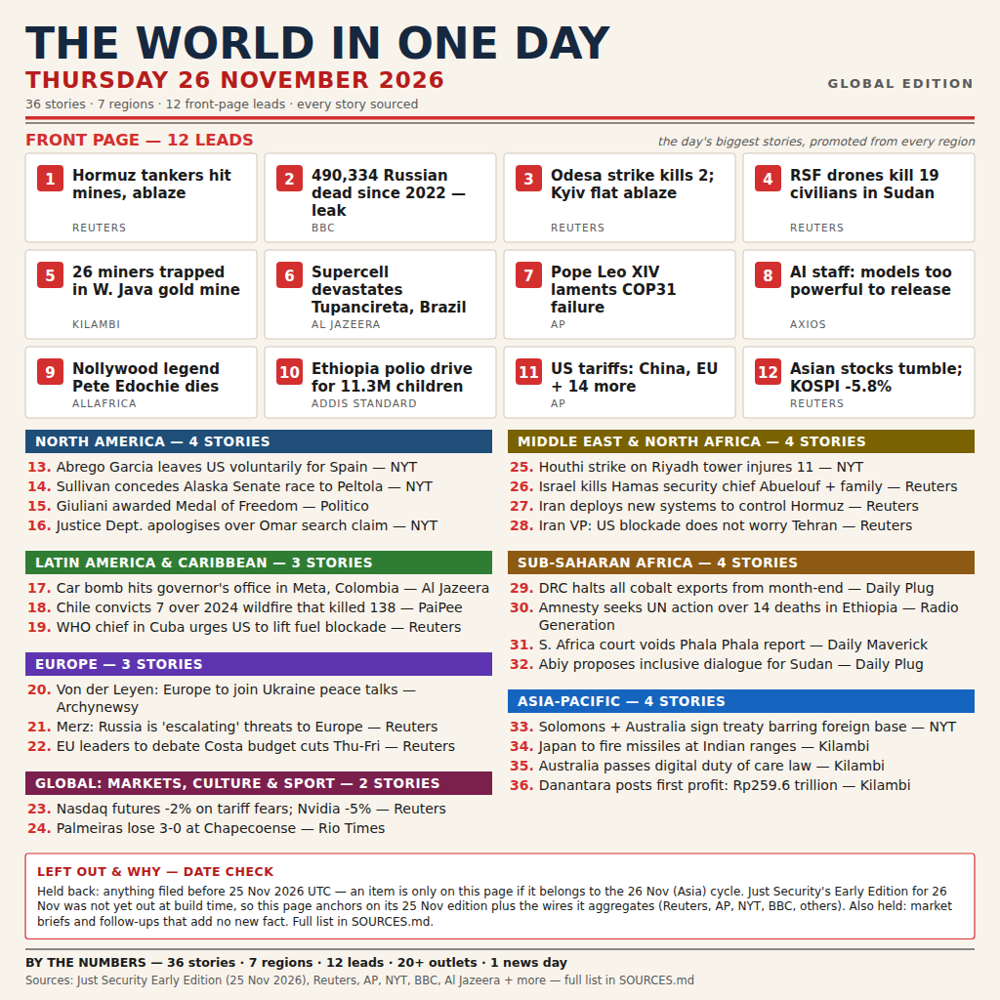

# The World in One Day — 26 November 2026

**Thursday 26 November 2026 — the whole world in one image.**

## What it is

One 1024×1024 broadsheet poster summing up 26 November 2026's world news:

- **Front page — 12 leads** in clean white boxes with solid red number
  chips: the day's biggest stories promoted from every region — the
  Hormuz tanker strikes, the leaked Russian toll of 490,334, the West
  Java mine rescue, the Tupancireta supercell, the COP31 failure, the
  death of Nollywood legend Pete Edochie — with finance deliberately
  capped at 2 of the 12 (the US tariff unveil and the KOSPI rout).
- **36 numbered stories across 7 regions** (North America 4, Latin
  America & Caribbean 3, Europe 3, Global: Markets, Culture & Sport 2,
  Middle East & North Africa 4, Sub-Saharan Africa 4, Asia-Pacific 4),
  each with its outlet cited on the poster.
- A **"left out & why" date-check box**: anything filed before the
  26 Nov (Asia) cycle is held back, and the page says so.
- A **by-the-numbers** strip and a sourced footer.

Every story belongs to the 26 November 2026 news cycle (filed 25 Nov
2026 UTC = 26 Nov in Asia), anchored on Just Security's Early Edition
for 25 Nov 2026 plus the wires it aggregates. Full verification links
are in [SOURCES.md](SOURCES.md).

## How it is built

- `build_poster.py` — authoring tool: emits `poster.svg` from the
  verified story data, measuring text with real font metrics so no
  box overflows (the SVG is a build artifact, not committed).
- `generate.mjs` — runs `build_poster.py`, then renders the SVG to
  `entry.png` (1024×1024) with headless Chromium.
- `main.ts` — the competition program: delivers `entry.png` byte for
  byte to the output directory and verifies the copy. It renders
  nothing, so the judged output is exactly the page above.

## License

MIT — see [LICENSE](LICENSE).

Built for the news-image-20261126 competition on https://make.fun
